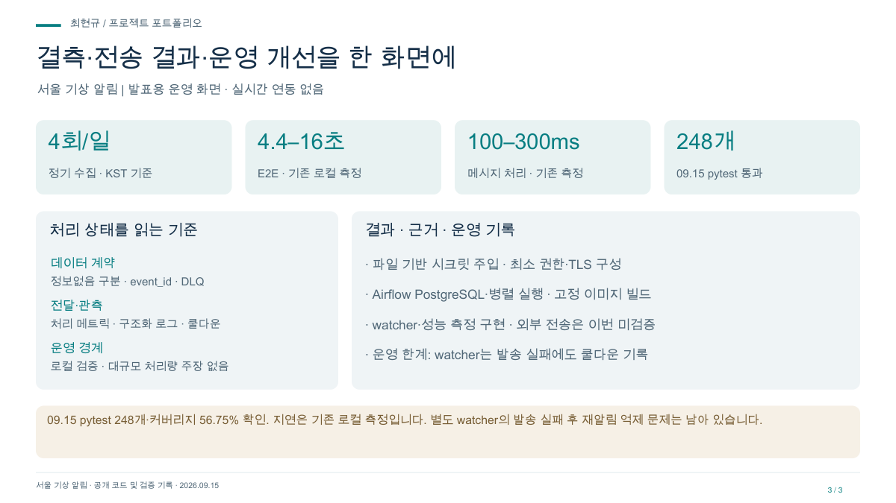

# 서울 기상 알림 발표 자료

공공 데이터를 상태 판정과 행동 권고로. 소개·처리 흐름·운영 관점으로 구성한 3장 자료입니다.

- [발표 PDF](project.pdf)
- [편집 가능한 PPT](project.pptx)
- [대시보드 미리보기](dashboard.png)

## 담당 범위

담당: 수집 · 이벤트 처리 · 저장 · 알림 · 운영 개선

## 검증 범위 · 2026-09-15

09.15 pytest 248개·커버리지 56.75% 확인. 지연은 기존 로컬 측정입니다. 별도 watcher의 발송 실패 후 재알림 억제 문제는 남아 있습니다.

실시간 관제 서비스가 아닌 발표용 화면입니다. 수치는 검증 시점 또는 예시 범위를 따릅니다.
